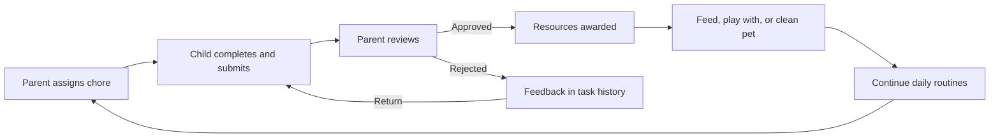
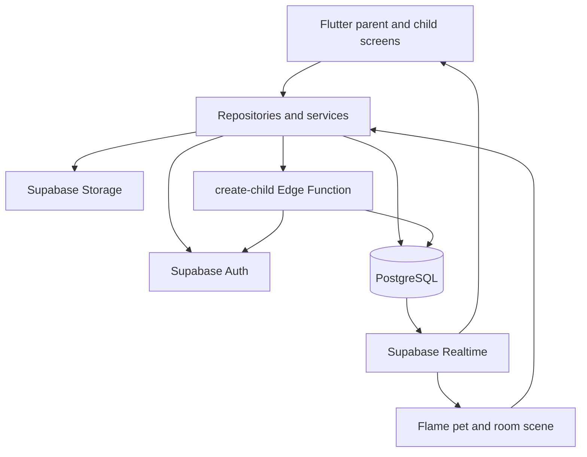

<p align="center">
  
</p>

# Happy Family Sim

**Turn everyday chores into care for a virtual pet.**

Happy Family Sim is a family chore tracker built with Flutter, Flame, and Supabase. Parents create tasks, review submissions, and reward completed work. Children use those rewards to feed, play with, and clean their animated pet, bringing a reason to return to their daily routines.

The project combines practical household task management with a pixel-art game. Photo evidence and parent review give families a way to verify completion, while pet care and room decoration make progress visible to children.

**Developers: Joanna Lin, Taylor Huang, William Hou, Zoey Lu** 

<p align="center">
  
</p>

## Contents

- [How it works](#how-it-works)
- [Features](#features)
- [Technology and architecture](#technology-and-architecture)
- [Getting started](#getting-started)
- [Supabase setup](#supabase-setup)
- [Try the full workflow](#try-the-full-workflow)
- [Project structure](#project-structure)
- [Development and verification](#development-and-verification)
- [Troubleshooting](#troubleshooting)
- [Project documentation and team](#project-documentation-and-team)

## How it works

1. **A parent assigns a chore.** Choose the child, due date, reward, and whether photo evidence is required. Set a recurring schedule for routines.
2. **The child submits their work.** View the task details, complete the chore, and attach a photo when required.
3. **The parent reviews the submission.** Approve the work to award resources, or reject it with feedback.
4. **The child cares for their pet.** Spend earned resources to improve the pet's fullness, happiness, and cleanliness.
5. **The family follows progress.** Review task history and completion statistics to see which routines are working.



## Features

### For parents

- **Account and family management:** Register with email and password, edit a profile, and create linked child accounts with six-digit login codes.
- **Flexible chore scheduling:** Create one-time or recurring tasks with daily, weekly, or monthly patterns and custom intervals. Assign tasks to one or more children.
- **Task organization:** Add descriptions, due dates, custom categories, and resource rewards; edit or delete tasks as routines change.
- **Submission review:** View pending work and photo evidence, approve completed chores, or reject submissions with written feedback.
- **Progress reports:** Explore task history, completion rates, category statistics, and tasks with the highest completion, rejection, or missed rates over a selected period.

### For children

- **A separate child experience:** Sign in using the parent's email and the child's six-digit code.
- **Clear task lists:** See assigned chores, deadlines, rewards, and submission status.
- **Photo submissions:** Attach evidence for chores that require it.
- **Reminders and review updates:** Receive reminders near a task's deadline and feedback when submitted work is reviewed while the relevant app screen is active.
- **Task history:** Look back at completed, rejected, and missed chores.

### Pet care and room decoration

The Flame game scene contains an animated cat, resource controls, status bars, and a customizable room. Pet condition decreases over time, including elapsed time away from the game, so caring for the pet remains an ongoing activity.

| Resource | Pet attribute | Interaction |
| --- | --- | --- |
| Food | Fullness | Feed the pet |
| Play | Happiness | Play with the pet |
| Clean | Cleanliness | Clean the pet |

Children can place, move, and remove owned furniture. The game also supports mystery boxes: five box pieces can be exchanged for an unowned cosmetic item when one is available in the catalog.

The current game balances are defined in [game_engine.dart](lib/features/game/game_engine.dart): a normal depletion tick is ten minutes, and applying a resource restores ten points to the corresponding attribute, up to 100.

## Technology and architecture

| Technology | Role |
| --- | --- |
| Flutter and Dart | Application UI, navigation integration, and client logic |
| Flame | Pet animation, game scene, interactions, and furniture rendering |
| Supabase Auth | Account authentication and sessions |
| Supabase PostgreSQL | Profiles, family links, chores, resources, and game state |
| Supabase Storage | Avatars and task proof images |
| Supabase Realtime | Resource streams and task review updates |
| `image_picker` | Image selection and capture integration |

The app uses a feature-based structure. UI code calls repositories and services to load and update Supabase data. Shared routing, constants, and widgets live in `lib/core/`; application dependencies are assembled in `lib/main.dart`.



Task definitions are separate from individual assignments: a `task_template` describes the chore, `task_recurrence` defines repetition, and `task_occurrence` tracks a child's assignment, deadline, status, proof URL, and review feedback. This supports recurring chores and assignments to multiple children without duplicating the entire definition.

## Getting started

### Prerequisites

- A Flutter SDK with Dart compatible with `^3.10.8` (`>=3.10.8 <4.0.0`), as required by [pubspec.yaml](pubspec.yaml). The development documentation records Flutter 3.41.2 as a development version.
- Git and an editor such as VS Code or Android Studio.
- A configured Supabase backend and an internet connection.
- The toolchain for your target platform:

| Target | Development requirements |
| --- | --- |
| Android | Android SDK, Android Studio, and an emulator or connected device |
| iOS | macOS, Xcode, CocoaPods, and a simulator or connected device |
| Windows | Windows and Visual Studio with the Desktop development with C++ workload |
| macOS | macOS and Xcode |

Android and iOS are the primary mobile targets described in the project documents. Windows and macOS runners are also included. This checkout does not include a Flutter `web/` runner; `docs/index.html` is a separate password-reset page.

### 1. Open the repository

Clone this repository using its GitHub clone URL, then open the project directory containing `pubspec.yaml`.

Check your development environment:

```sh
flutter doctor
```

Resolve any reported issues for the platform you intend to use.

### 2. Create `.env`

Create a file named `.env` in the project root, beside `pubspec.yaml`:

```dotenv
SUPABASE_URL=https://YOUR_PROJECT_ID.supabase.co
SUPABASE_ANON_KEY=YOUR_SUPABASE_PUBLISHABLE_OR_ANON_KEY
```

Both values must belong to the same configured Supabase project. For the team's existing backend, obtain the configuration from a maintainer. For a new backend, complete the [Supabase setup](#supabase-setup) below.

`.env` is already excluded by `.gitignore` and declared as a Flutter asset. It is bundled with the application, so it must contain only client configuration. Never place a service-role key or other server secret in this file.

### 3. Install dependencies

```sh
flutter pub get
```

### 4. Start a device and run

Launch an Android emulator, start an iOS simulator on macOS, or connect a physical device. Then run:

```sh
flutter devices
flutter run
```

To select a specific device, replace `DEVICE_ID` with an ID from `flutter devices`:

```sh
flutter run -d DEVICE_ID
```

For Windows desktop development:

```sh
flutter run -d windows
```

## Supabase setup

**A new, empty Supabase project is not sufficient to run all features.** This repository contains client code and the child-creation function, but no database migrations or complete seed scripts. Obtain the schema, constraints, defaults, policies, and seed data from a maintainer when reproducing the backend.

The current source references these tables:

| Area | Tables |
| --- | --- |
| Accounts and families | `profiles`, `family_links` |
| Chores and schedules | `task_category`, `task_template`, `task_recurrence`, `task_occurrence` |
| Pet care | `creatures`, `resources` |
| Room decoration | `cosmetic_items`, `child_owned_cosmetics`, `room_placements` |

The backend also needs:

- **Email/password authentication** configured for parent registration and child login.
- **Row Level Security policies** matching parent/child ownership and permitted operations.
- **Storage buckets** named `avatars` and `task_proofs`, with suitable upload and read policies. The default avatar path is `system/default_avatar.png` inside `avatars`.
- **Realtime configuration** for the resource and task occurrence updates used by the client.
- **Cosmetic catalog data** matching the furniture assets and sprite metadata in the repository.
- **The `create-child` Edge Function**, available in [supabase/functions/create-child](supabase/functions/create-child/), deployed to the same project as the app. It reads `SUPABASE_URL` and `SUPABASE_SERVICE_ROLE_KEY` from its server environment.

The photo code currently builds public URLs for avatar and proof images. A private storage deployment requires corresponding client changes, such as authenticated downloads or signed URLs. The UI's role checks do not replace database policies or server-side authorization.

### Password-reset page

[docs/index.html](docs/index.html) is a standalone browser page for setting a new password. To use it with another backend:

1. Set its `projectUrl` and `anonKey` to that backend's public client configuration.
2. Host the page at an accessible HTTPS address.
3. Configure Supabase Auth's recovery redirect settings and email flow to return users to that address.
4. Test the full flow from the app's **Forgot password** screen through the email link.

The HTML page does not read the Flutter `.env` file. Updating `.env` alone does not change the page's configuration.

## Try the full workflow

Once the backend is configured, use this walkthrough to explore the main features:

1. Register a parent account and open child management.
2. Create a child account and note its six-digit login code.
3. Create a chore, assign it to that child, choose a resource reward, and require a photo if desired.
4. Sign in as the child using the parent's email and the child's code.
5. Submit the chore, including evidence when required.
6. Return to the parent account and approve the submission.
7. Sign in as the child, open the game, and use the awarded resource when the corresponding pet attribute is below 100.
8. Open the parent's history and analytics views to see the completed task reflected in the reports.

## Project structure

```text
lib/
  main.dart                 # App initialization and dependency assembly
  core/                     # Routing, constants, utilities, shared widgets
  features/
    auth/                   # Registration, login, password recovery
    management/             # Child account creation and family management
    profile/                # Parent and child profiles
    tasks/                  # Chore definitions, scheduling, submissions, history
    approval/               # Parent review and resource rewards
    analytics/              # Reports and completion statistics
    game/                   # Flame engine, pet, furniture, resources, cosmetics
assets/images/              # Branding, backgrounds, sprites, furniture metadata
supabase/
  config.toml               # Edge Function configuration
  functions/create-child/   # Server-side child account creation
docs/                       # Password-reset page and sprint documents
ref/                        # Design document and initial sprint planning
tools/                      # Sprite extraction utility
android/                    # Android runner
ios/                        # iOS runner
macos/                      # macOS runner
windows/                    # Windows runner
```

## Development and verification

Place new features under `lib/features/<feature>/`, keeping presentation in `ui/` and data access in `data/` where that structure fits. Reuse shared components from `lib/core/` and register new routes in [router.dart](lib/core/router.dart).

Run static analysis when changing Dart code:

```sh
flutter analyze
```

The repository declares `flutter_test` and `mocktail`.

For manual verification, cover both account roles, recurring task creation, photo submission, approval and rejection, resource updates, pet care, and report totals. Also check that one family's account cannot access another family's records.

Current implementation boundaries to keep in mind:

- Backend migrations and seed data are not included, so a fresh deployment requires additional setup.
- The Android release configuration currently uses debug signing; distribution requires a proper release-signing setup.

## Troubleshooting

| Symptom | What to check |
| --- | --- |
| `.env` cannot be loaded or Supabase initialization fails | Confirm `.env` is in the project root and both expected values are populated. Restart the app after configuration changes. |
| No device is available | Start an emulator or connect a device, then check `flutter devices` and `flutter doctor`. |
| Tables are missing or queries fail | Confirm the backend schema matches the source, including foreign keys, defaults, and policies. |
| A query returns no data or permission errors | Check the signed-in user, family links, and Row Level Security policies for the requested operation. |
| Child account creation fails | Check the `create-child` deployment, server environment, function logs, and account/profile constraints. |
| Images fail to upload or display | Check bucket names, storage policies, object paths, and the current public-URL assumptions. |
| Review or resource updates do not appear | Check Realtime configuration and reconnect or reload the relevant screen. |
| Password-reset links reach the wrong page | Check Supabase recovery redirects and the separate configuration in `docs/index.html`. |

## Project documentation and team

The project documents explain the original requirements, design decisions, and sprint scope:

- [Design document](ref/Design%20Doc.docx)
- [Sprint 1 planning](ref/Sprint%20Planning%201.txt)
- [Sprint 2 planning](ref/Sprint%20Planning%202.md)
- [Sprint 3 planning](ref/Sprint%20Planning%203.md)

The implementation has evolved since the original design. Use the current source and [pubspec.yaml](pubspec.yaml) for active behavior and dependency requirements.

**Team 21:** Joanna Lin, Taylor Huang, William Hou, and Zoey Lu.
